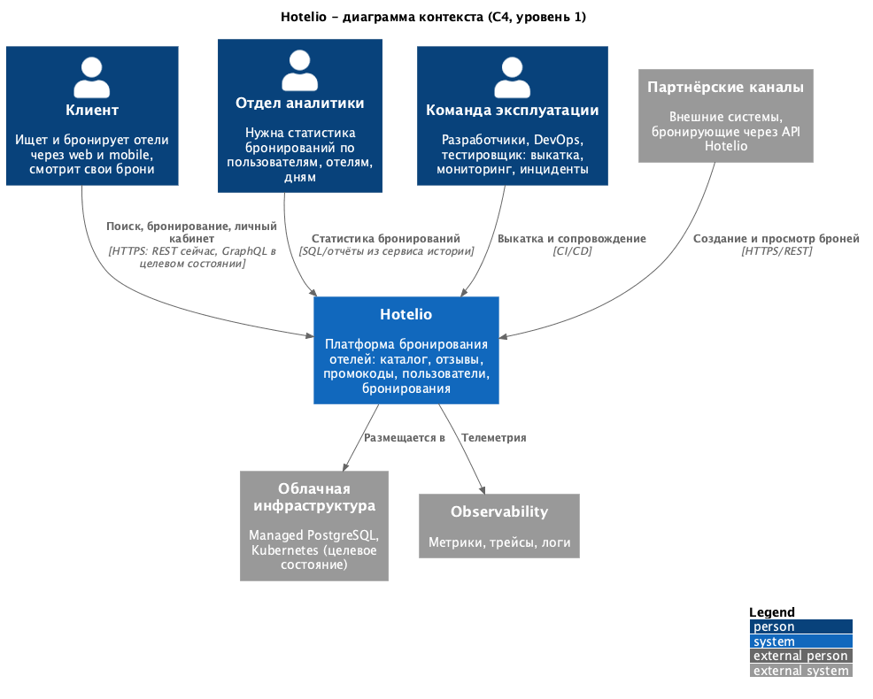
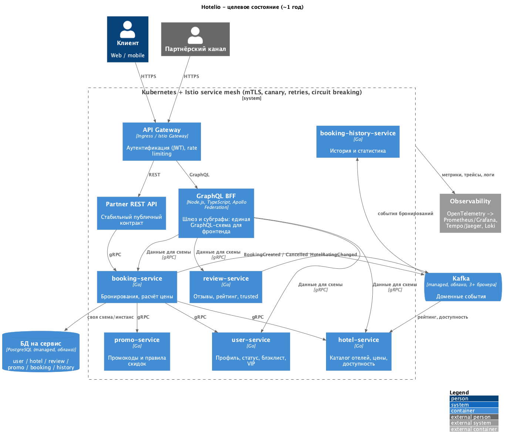

# ADR-001. Целевая архитектура Hotelio и план перехода на микросервисы

### **Название задачи:** Переход Hotelio от монолита к микросервисной архитектуре: целевое состояние, подход и план миграции

### **Автор:** Bulat Aikaev

### **Дата:** 2026-10-11

Связанные решения: [ADR-002 - первый выносимый модуль и промежуточное состояние](ADR-002-booking-first.md).

### **Функциональные требования**

Миграция не должна сломать ни один существующий сценарий (UC-1 - UC-6) и должна дать возможность реализовать новые (UC-7, UC-8).

| № | Действующие лица или системы | Use Case | Описание |
| :-: | :- | :- | :- |
| UC-1 | Клиент, партнёрский канал | Поиск отелей | Поиск отелей по городу и рейтингу, просмотр карточки отеля |
| UC-2 | Клиент | Просмотр отзывов и надёжности отеля | Отзывы об отеле и признак его надёжности |
| UC-3 | Клиент, партнёрский канал | Создание бронирования | Создание брони с проверками пользователя, отеля и промокода и расчётом цены |
| UC-4 | Клиент, партнёрский канал | Просмотр бронирований | Список броней - всех или одного пользователя |
| UC-5 | Клиент, внутренние модули | Проверка промокода | Проверка действительности промокода для пользователя |
| UC-6 | Внутренние модули, оператор | Проверка статуса пользователя | Статус пользователя: активность, чёрный список, VIP |
| UC-7 (новый) | Отдел аналитики | Статистика бронирований | Статистика бронирований для аналитики без доступа к боевой БД |
| UC-8 (новый) | Клиент (фронтенд) | Личный кабинет | Брони пользователя вместе с отелями одним запросом, только свои |

Пошаговое описание:

**UC-1. Поиск отелей**

1. Клиент запрашивает отели в городе или топ по рейтингу (`/api/hotels/by-city`, `/top-rated`).
2. Система возвращает список отелей.
3. Клиент открывает карточку отеля (`/api/hotels/{id}`).

**UC-2. Просмотр отзывов и надёжности отеля**

1. Клиент запрашивает отзывы отеля (`/api/reviews/hotel/{id}`).
2. Система возвращает отзывы и признак "надёжный" (>= 10 отзывов, средняя оценка >= 4.0).

**UC-3. Создание бронирования**

1. Клиент отправляет `userId`, `hotelId`, опционально `promoCode`.
2. Система проверяет, что пользователь активен и не в чёрном списке.
3. Проверяет, что отель работает, надёжен по отзывам и не полностью забронирован.
4. Определяет базовую цену по статусу клиента (VIP / обычный).
5. Проверяет промокод с учётом VIP-статуса и применяет скидку.
6. Сохраняет бронь и возвращает её.
7. При нарушении любого правила - отказ.

**UC-4. Просмотр бронирований**

1. Клиент запрашивает брони (все или по `userId`).
2. Система возвращает список с ценой, скидкой и датой создания.

**UC-5. Проверка промокода**

1. Клиент или модуль бронирования передаёт код и пользователя.
2. Система проверяет срок, VIP-ограничение и возвращает промокод со скидкой или отказ.

**UC-6. Проверка статуса пользователя**

1. Запрос по `userId`.
2. Система возвращает статус, активность, чёрный список, VIP, признак авторизации.

**UC-7 (новый). Статистика бронирований**

1. Каждая созданная бронь асинхронно попадает в хранилище истории.
2. Аналитик получает статистику по пользователям, отелям, дням без доступа к боевой БД.

**UC-8 (новый). Личный кабинет**

1. Фронтенд одним запросом получает брони пользователя вместе с данными отелей.
2. Пользователь видит только свои брони.

### **Нефункциональные требования**

| № | Требование |
| :-: | :- |
| НФТ-1 | **Масштабируемость.** Создание и просмотр броней масштабируются независимо от остальных функций на пиковой нагрузке (~ 1 млн пользователей, основной трафик - поиск и бронирование) |
| НФТ-2 | **Независимая разработка и поставка.** Изменение одного домена выкатывается без релиза остальных; у каждого сервиса свой CI/CD-пайплайн |
| НФТ-3 | **Постепенность и обратимость.** Переход по Strangler Fig: по одному компоненту, каждый шаг можно откатить конфигурацией без потери данных |
| НФТ-4 | **Совместимость.** Внешний REST-контракт для существующих клиентов и партнёров не меняется на время миграции |
| НФТ-5 | **Отказоустойчивость.** Отказ некритичных компонентов (история, аналитика) не останавливает бронирование; межсервисные вызовы с таймаутами, ретраями и circuit breaker |
| НФТ-6 | **Сохранность данных.** Перезапуск или выкатка новой версии сервиса не приводит к потере данных; схема БД меняется только версионированными миграциями |
| НФТ-7 | **Разделение данных.** У каждого сервиса своя БД; чужие данные - только через API или события. Через ~2 месяца начато разделение БД, через год - переезд в облако |
| НФТ-8 | **Безопасность.** Аутентификация на входе, `userId` берётся из токена; пользователь видит только свои брони; PII не отдаётся без необходимости |
| НФТ-9 | **Наблюдаемость.** Health-checks, метрики и распределённая трассировка на каждый сервис; понятные коды ошибок (4xx для бизнес-отказов) |
| НФТ-10 | **Ограничение ресурсов.** Решение по силам команде из 2 бэкенд-разработчиков, архитектора, фронтендера и одного DevOps; инфраструктура - PostgreSQL, Kafka, Docker |
| НФТ-11 | **Заморозка монолита.** Через ~2 месяца новая функциональность пишется только в вынесенных сервисах |
| НФТ-12 | **Без простоя.** Перенос данных, переключение модуля на сервис и откат не останавливают обслуживание клиентов |
| НФТ-13 | **Эффективное использование ресурсов.** Новые сервисы экономно расходуют CPU и память и быстро стартуют: горизонтальное масштабирование дешевле, а перезапуски, rolling update и canary - быстрее |

### **Решение**

#### Контекст

[`diagrams/00-context.png`](diagrams/00-context.png)

#### Исходное состояние и проблемы

Hotelio - Spring Boot-монолит из пяти модулей (`Booking`, `User`, `Hotel`, `Promo`, `Review`): все они собираются и разворачиваются как одно приложение и работают с одной базой PostgreSQL. Компонентная диаграмма - [`diagrams/01-as-is.png`](diagrams/01-as-is.png).

Бизнес-проблемы, заявленные компанией:

| # | Бизнес-проблема |
|---|---|
| Б1 | Сложность сопровождения: изменение требует понимания всей кодовой базы |
| Б2 | Нельзя масштабировать только нагруженную часть (бронирование), производительность неравномерна |
| Б3 | Команды не могут работать независимо, нет быстрого CI/CD - долгий time-to-market |
| Б4 | Универсальный REST плохо подходит фронтенду, нет BFF |
| Б5 | Высокий риск ошибок при запуске фич из-за связанности, тестирование требует знания всех зависимостей |

Проблемы архитектуры:

| # | Область | Проблема | Наблюдения | Последствия для бизнеса |
|---|---|---|---|---|
| П1 | Масштабируемость | Система масштабируется только целиком: один процесс, одна БД и один пул соединений на все модули | Чтобы выдержать пик бронирований, приходится запускать копии всего монолита, а все копии упираются в одну БД | На пиках деградирует вся платформа, а не только бронирование; масштабирование ненагруженных частей - лишние расходы (Б2) |
| П2 | Производительность | Критичный путь бронирования - длинная синхронная цепочка, стоимость которой растёт вместе с объёмом данных | Проверки пользователя, отеля, отзывов и промокода выполняются последовательно в одном запросе - 4 запроса к БД на бронь; "надёжность" отеля пересчитывается по всем его отзывам на каждую бронь | Время бронирования растёт вместе с объёмом данных - падает конверсия |
| П3 | Производительность | Аналитике негде брать данные, кроме боевой БД | Нет отдельного хранилища истории и событий | Отчёты конкурируют с клиентским трафиком; DevOps справедливо не даёт доступ |
| П4 | Производительность (клиенты) | API одно и универсальное для всех клиентов, нет BFF | Экран "мои брони с отелями" собирается несколькими последовательными запросами | Медленный интерфейс, дорогая разработка под каждую платформу (Б4) |
| П5 | Надёжность | Единая точка отказа, нет изоляции отказов: сбой, утечка ресурсов или медленный запрос в любом модуле останавливает всё приложение, включая бронирование | Модули вызывают друг друга напрямую в одном процессе, без таймаутов; если модуль сбоит, запасного сценария нет - запрос просто падает | Простой бронирования = прямая потеря выручки |
| П6 | Надёжность (согласованность) | Нет контроля доступности номеров при конкурентных бронированиях | "Отель заполнен" - ручной флаг, в брони нет дат | Овербукинг на пиковой нагрузке |
| П7 | Наблюдаемость | Нет health-checks, метрик, трассировки и корреляции запросов; бизнес-отказ неотличим от сбоя | Любой отказ в бронировании - HTTP 500 без причины; в приложении нет actuator и экспорта метрик | Инциденты долго обнаруживаются и разбираются (высокий MTTR); нет данных для планирования мощностей |
| П8 | Безопасность | Нет аутентификации и авторизации: клиент сам передаёт идентификатор пользователя | Можно создать или прочитать брони за другого пользователя, получить чужие персональные данные | Утечки ПДн, мошенничество, регуляторные и репутационные риски |
| П9 | Сопровождаемость | Высокая связанность: модули вызывают друг друга напрямую и делят сущности и схему БД; ключевой интеграционный компонент (gRPC-прокси) - бинарная библиотека без исходников | `BookingService` зависит от четырёх модулей, `Promo` - от `User`; контроллер отзывов работает с БД в обход сервиса | Любое изменение требует знания всей системы, изменения в одном модуле ломают другие (Б1, Б5) |
| П10 | Тестируемость | Нет автотестов на уровне модулей; единственная проверка - сквозной регресс, который требует поднять всё приложение с общей БД и проверяет только HTTP-статусы | Тест "отказ: отель не доверенный" получает отказ, потому что отель закрыт, а тест "отказ: отель заполнен" - потому что отель не доверенный. Оба видят ожидаемый HTTP 500 и проходят, а правило "отель заполнен" не проверяет ни один тест | Медленный и рискованный выпуск, регрессии доходят до прода (Б5) |
| П11 | Поставка (time-to-market) | Один релизный цикл и один артефакт на все команды, нет CI/CD | Любое изменение - сборка и выкатка всего монолита; откатить можно только всё приложение целиком | Команды ждут друг друга, фичи выходят медленно (Б3) |

#### Целевое состояние (~1 год) - контейнеры

[`diagrams/03-to-be.png`](diagrams/03-to-be.png)

| Контейнер | Ответственность | Хранилище | Интеграции |
|---|---|---|---|
| API Gateway (Istio Gateway / Ingress) | Аутентификация (JWT), rate limiting, маршрутизация | - | HTTPS от клиентов и партнёров |
| GraphQL BFF (Node.js, TypeScript, Apollo Federation) | Шлюз и субграфы: единая GraphQL-схема для фронтенда, собранная из частей по доменам; контроль доступа на уровне полей | - | gRPC к сервисам на Go |
| Partner REST API | Стабильный публичный контракт для партнёров | - | gRPC к `booking-service` |
| `booking-service` | Создание и просмотр броней, расчёт цены | своя БД | gRPC к `user`, `promo`, `hotel`; события в Kafka |
| `booking-history-service` | История и статистика для аналитики | своя БД | Подписчик Kafka |
| `hotel-service` | Каталог отелей, цены, доступность | своя БД | События рейтинга из Kafka |
| `review-service` | Отзывы, рейтинг, "надёжность" | своя БД | Публикует `HotelRatingChanged` |
| `promo-service` | Промокоды и правила скидок | своя БД | gRPC |
| `user-service` | Профиль, статус, чёрный список, VIP | своя БД | gRPC |
| Kafka (managed, в облаке, 3+ брокера) | Доменные события; вне Kubernetes, как и БД | - | Все сервисы |
| Kubernetes + Istio | Развёртывание, mTLS, canary, ретраи, circuit breaking | - | Все сервисы |
| Observability (OpenTelemetry -> Prometheus/Grafana, Tempo/Jaeger, Loki) | Метрики, трейсы, логи | - | Все сервисы |

#### Подход к миграции

Переход идёт по паттерну **Strangler Fig**: монолит остаётся единой точкой входа для существующих клиентов, а модули по одному выносятся в отдельные сервисы.

Вынос каждого модуля проходит одни и те же шаги:

1. **Точка переключения.** В монолите появляется прокси или фасад, который направляет вызовы модуля во внешний сервис. Включается и выключается конфигурацией. Позже маршрутизацию забирает API Gateway (см. "Маршрутизация").
2. **Сервис с паритетом поведения.** Логика переносится один в один; регрессионные тесты должны давать одинаковый результат против монолита и против сервиса. Изменения бизнес-правил - отдельными задачами после переключения.
3. **Данные.** У сервиса своя БД. Данные модуля переносятся, пока монолит продолжает работать: начальная копия, затем дозагрузка новых записей (см. "Перенос данных и переключение без простоя"). Данные невынесенных модулей сервис не копирует, а получает через API монолита - только через Anti-Corruption Layer.
4. **Переключение и откат.** Трафик переводится без простоя. На период отката новые записи сервиса синхронизируются обратно в монолит через события, чтобы возврат не терял данные.
5. **Удаление старой реализации.** После периода стабильной работы код модуля, синхронизация и legacy-таблицы удаляются из монолита.

#### Anti-Corruption Layer

Пока идёт миграция, новые сервисы обмениваются данными с монолитом. Чтобы модель и проблемы монолита не проникали в новые сервисы, всё взаимодействие с ним идёт через **Anti-Corruption Layer (ACL)** - слой-адаптер, который переводит данные из модели одной стороны в модель другой: форматы, названия полей и значения, коды ошибок. Например, ответ монолита "404" адаптер превращает в понятное сервису "пользователь не найден".

| Направление | Где живёт ACL | Что делает |
|---|---|---|
| Сервис -> монолит | Модуль-адаптер внутри нового сервиса - клиент API монолита | Переводит ответы монолита в собственные модели сервиса; превращает ошибки монолита в понятные сервису исходы ("нет данных", "монолит недоступен"); задаёт таймауты. Доменная логика сервиса не знает о модели монолита |
| Монолит -> сервис | Точка переключения в монолите | Переводит сущности монолита в контракт сервиса (`.proto`) и обратно - внешний контракт монолита не меняется |
| Сервис -> legacy-таблицы | Временный потребитель событий | Переводит доменные события сервиса в формат legacy-таблиц на период отката |

ACL появляется вместе с первым сервисом, которому нужен монолит, и убирается по частям: адаптер к модулю монолита заменяется клиентом нового сервиса, когда этот модуль вынесен. Когда вынесены все модули, ACL исчезает вместе с монолитом.

#### Маршрутизация

| Период | Внешний трафик (клиенты -> система) | Трафик между сервисами |
|---|---|---|
| Переходный (до этапа "Платформа") | Через монолит: его точка переключения направляет вызовы вынесенного модуля в сервис. Новая инфраструктура не нужна | Прямые вызовы gRPC/REST с таймаутами |
| После этапа "Платформа" | API Gateway направляет запросы к вынесенным модулям прямо в сервисы, монолит выходит из их пути. Остальные запросы шлюз отдаёт монолиту | Service mesh (Istio): mTLS, ретраи, circuit breaking, canary |

Чтобы шлюз мог вести клиентов напрямую, вынесенный сервис должен отдавать прежний внешний REST-контракт - собственным REST-фасадом или через Partner API.

#### Перенос данных и переключение без простоя

Монолит работает и пишет данные до самого переключения, поэтому одной копии недостаточно. Данные переносит **задача миграции** - временный скрипт, который запускает DevOps. Это не сервис: после переключения задачу останавливают и удаляют вместе с остальной миграционной обвязкой.

| Фаза | Что происходит |
|---|---|
| Начальная копия | Пока монолит работает, задача миграции копирует в БД сервиса всё, что есть на этот момент, и сверяет количество и контрольные суммы |
| Дозагрузка новых записей | Задача миграции запускается повторно и переносит записи, которые монолит создал после предыдущего запуска. Во время переключения она работает непрерывно - раз в несколько секунд |
| Переключение | Трафик постепенно переходит на сервис. Записи, созданные сервисом, возвращаются в legacy-таблицу событиями; чтение защищено от отставания (см. ниже) |
| После переключения | Последняя дозагрузка и сверка; задачу миграции и чтение из старой БД отключают. Пишет только сервис; обратная синхронизация остаётся на период отката |

Как найти новые записи, зависит от таблицы:

- **Строки только добавляются.** Новые записи - строки с идентификатором больше последнего перенесённого. Просто и точно.
- **Строки изменяются или удаляются.** Нужен CDC - чтение изменений из журнала PostgreSQL (например, Debezium). Сравнение по времени изменения пропускает удаления и требует поля, которого в монолите нет.

Пока обе стороны пишут одновременно, идентификаторы не должны пересекаться: сервис выдаёт свои из отдельного диапазона, начинающегося заведомо выше идентификаторов монолита. Строки из этого диапазона, вернувшиеся в монолит через обратную синхронизацию, задача миграции пропускает.

Как переключать трафик без простоя:

- **Пока маршрутизирует монолит.** Точка переключения включается конфигурацией при старте, поэтому экземпляры монолита (их должно быть не меньше двух) перезапускаются поочерёдно, а балансировщик обслуживает клиентов оставшимися. Откат - так же, в обратную сторону.
- **После этапа "Платформа".** Переключение - смена правила маршрута в API Gateway, без перезапусков; можно переводить трафик долями.

Как не потерять только что созданные записи при чтении. Пока часть экземпляров уже работает с сервисом, а часть ещё нет, запись могла быть создана одной стороной и ещё не дойти до другой. Без защиты клиент сразу после создания брони мог бы получить "не найдено". Поэтому на время переключения чтение защищается маршрутизацией:

- **Чтение из двух источников в сервисе.** Сервис ищет запись в своей БД, а если не нашёл - в legacy-таблице монолита; списки собирает из обоих источников без дублей. Так сервис видит записи, созданные старыми экземплярами монолита, ещё до дозагрузки. Legacy-таблица хранит данные того же домена, поэтому чтение из неё - только на чтение, отдельным пользователем БД и через ACL - не протаскивает в сервис чужую модель.
- **Привязка клиента к экземпляру на балансировщике** (sticky sessions). Запросы одного клиента на время переключения идут в один и тот же экземпляр монолита, поэтому запись, созданная через новый экземпляр, читается им же - через сервис. Остаётся момент, когда перезапускается сам экземпляр клиента; его закрывает обратная синхронизация, которая обычно укладывается в доли секунды.

Чтение из двух источников - временная мера: после переключения и последней дозагрузки его выключают, и сервис больше не зависит от старой БД.

#### Порядок выноса

Порядок выноса определяется критериями:

| Критерий | Чем выше, тем раньше выносим |
|---|---|
| Польза для бизнеса | Нагрузка, которую нужно масштабировать отдельно; доля выручки; частота изменений |
| Независимость | Меньше модулей, которые вызывают этот модуль и которые придётся менять при выносе |
| Изоляция данных | Таблицы модуля не читают другие модули - их можно сразу вынести в отдельную БД |
| Готовая точка переключения | В монолите уже есть прокси или фасад для этого модуля |
| Обратимый риск | Ошибку можно откатить конфигурацией без потери данных |

Модули, от которых зависят многие другие и которые связаны с аутентификацией, выносятся последними. Выбор первого модуля и его промежуточное состояние описаны в [ADR-002](ADR-002-booking-first.md).

#### План миграции

| Этап | Что делаем | Критерий готовности |
|---|---|---|
| 0. Подготовка | Health-checks и метрики (П7); заморозка фич в монолите; регрессионные тесты, проверяющие причину каждого отказа (П10) | Есть метрики и health-checks; регресс зелёный и покрывает все ветки валидации |
| 1. Первый модуль | Вынос по описанным шагам; модуль выбирается по критериям выше ([ADR-002](ADR-002-booking-first.md)) | Вызовы модуля обслуживает новый сервис, регресс зелёный, переключение и откат проверены без простоя |
| 2. События и аналитика | Kafka + transactional outbox, сервис истории бронирований | Статистика считается без запросов к боевой БД монолита |
| 3. BFF | GraphQL Federation над вынесенными сервисами и монолитом, контроль доступа | Личный кабинет работает через BFF |
| 4. Платформа | Kubernetes, Helm, CI/CD; API Gateway забирает маршрутизацию вынесенных модулей у монолита; затем Istio (canary, retries, circuit breaking) | Сервисы выкатываются пайплайном, canary без ручных шагов; запросы к вынесенным модулям не проходят через монолит |
| 5. Остальные модули | По одному, в порядке критериев; связи между доменами - через события; переезд БД в облако | Монолит выключен, у каждого сервиса своя БД |

#### Логика решений и покрытие требований

| Требование | Как закрывается |
|---|---|
| UC-1 - UC-6 | Сохраняются без изменения внешнего контракта: монолит остаётся фасадом, вызовы вынесенных модулей проксируются (Strangler Fig) |
| UC-7 | `booking-history-service` строит статистику по событиям `BookingCreated` из Kafka - без доступа к боевой БД |
| UC-8 | GraphQL BFF агрегирует брони и отели одним запросом; контроль доступа по `userid` |
| НФТ-1 | Каждый домен - отдельный сервис, масштабируется горизонтально; тяжёлые вычисления (рейтинг) уходят в события |
| НФТ-2 | Сервисы по бизнес-возможностям, свой репозиторий/пайплайн, контракты - `.proto` и GraphQL-схемы; Anti-Corruption Layer не даёт модели монолита проникнуть в сервисы |
| НФТ-3 | Точка переключения в монолите управляется конфигурацией; данные синхронизируются обратно на период отката |
| НФТ-4 | REST-контракт монолита не меняется; после этапа "Платформа" тот же контракт отдают API Gateway и сервисы |
| НФТ-5 | Синхронно - только то, что нужно для ответа; остальное - асинхронно через Kafka. Таймауты на вызовы сразу, circuit breaker и ретраи - в Istio |
| НФТ-6 | Версионированные миграции в каждом сервисе; запись данных и события - в одной транзакции (outbox) |
| НФТ-7 | База на сервис: сначала отдельные инстансы в Docker, затем managed PostgreSQL в облаке |
| НФТ-8 | Аутентификация на API Gateway, контроль доступа в BFF, `userId` из токена |
| НФТ-9 | Actuator/health в каждом сервисе, OpenTelemetry, gRPC-статусы с причиной отказа |
| НФТ-10 | Знакомая команде инфраструктура (PostgreSQL, Kafka); шесть сервисов, а не десятки; платформа вводится поэтапно |
| НФТ-11 | Заморозка монолита - часть этапа 0 |
| НФТ-12 | Начальная копия и дозагрузка новых записей, пока монолит работает; непересекающиеся идентификаторы; чтение из двух источников и привязка клиента к экземпляру на время переключения; поочерёдный перезапуск монолита, позже - переключение маршрута в API Gateway |
| НФТ-13 | Новые сервисы пишутся на Go: статический бинарник в минимальном образе, низкое потребление памяти, старт за доли секунды |

Выбор технологий:

- **Go для новых сервисов** - решение команды, у которой есть опыт с Go. Сервис на Go - один статический бинарник в минимальном образе: он расходует заметно меньше памяти и CPU, чем JVM-сервис, и стартует за доли секунды. Это делает горизонтальное масштабирование дешевле, а перезапуски и canary-выкатки быстрее (НФТ-1, НФТ-13). Стандартная библиотека и зрелые библиотеки закрывают всё нужное: gRPC, Kafka, PostgreSQL. Монолит остаётся на Java/Spring Boot до выключения - он заморожен, и новый код в нём не пишется.
- **gRPC** между сервисами - строгий контракт (`.proto`), кодогенерация, низкие накладные расходы.
- **Kafka** для событий - уже есть в инфраструктуре, хранит события для повторного чтения новыми потребителями (история, будущий DWH).
- **Transactional outbox** вместо прямой публикации - событие не теряется при сбое между записью в БД и отправкой.
- **Kafka и PostgreSQL - managed-сервисы вне Kubernetes.** В кластере только stateless-сервисы: их легко масштабировать, перезапускать и выкатывать через canary. Состояние (брокеры, БД) требует постоянных томов, аккуратных обновлений и ребалансировки - это эксплуатация, на которую у одного DevOps нет ресурса (НФТ-10). Istio таким компонентам ничего не даёт: клиенты Kafka и PostgreSQL ходят по своим протоколам, а не по HTTP/gRPC.
- **PostgreSQL на сервис** - тот же движок, без новых компетенций; версионированные миграции встроены в каждый сервис.
- **Apollo Federation на Node.js/TypeScript** для BFF - каждый домен описывает свою часть схемы в своём субграфе, шлюз собирает их в одну. BFF - слой для фронтенда, поэтому он на JavaScript/TypeScript: команда знает этот стек, Apollo - эталонная реализация Federation на Node.js, а фронтенд-разработчик может сам менять схемы. Доменная логика в BFF не попадает - субграфы берут данные у сервисов на Go по gRPC.
- **API Gateway** для внешнего трафика - аутентификация, rate limiting и маршрутизация между монолитом и сервисами в одном месте.
- **Kubernetes + Istio** для трафика между сервисами - canary, ретраи и circuit breaking без изменения кода сервисов. Mesh вводится последним, когда команда освоит Kubernetes.

### **Альтернативы**

**Стратегия перехода**

| Вариант                                          | Плюсы                                                        | Минусы                                                                                        | Решение                           |
| ------------------------------------------------ | ------------------------------------------------------------ | --------------------------------------------------------------------------------------------- | --------------------------------- |
| Переписать систему целиком и переключиться разом | Чистая архитектура сразу                                     | Долго без бизнес-ценности, высокий риск; при двух бэкенд-разработчиках нереалистично (НФТ-10) | Отклонён                          |
| Модульный монолит - навести границы внутри       | Дёшево, без сетевых издержек                                 | Не даёт независимого масштабирования и деплоя (НФТ-1, НФТ-2)                                  | Частично: как подготовка к выносу |
| **Strangler Fig** - выносить по одному модулю    | Постепенно, обратимо, ценность с первого шага (НФТ-3, НФТ-4) | Период сосуществования, временная синхронизация данных, обратные вызовы в монолит             | **Выбран**                        |

**Язык новых сервисов**

| Вариант | Плюсы | Минусы | Решение |
|---|---|---|---|
| Java / Spring Boot, как монолит | Команда уже знает; можно переносить код модулей почти без изменений | JVM требует больше памяти и дольше стартует: масштабирование дороже, перезапуски и canary медленнее (НФТ-13) | Отклонено |
| **Go** | Малый расход CPU и памяти, быстрый старт, один статический бинарник; хорошая поддержка gRPC и Kafka; у команды есть опыт с Go | На время миграции - два стека: Java в монолите и Go в сервисах | **Выбрано** |

**Взаимодействие сервисов**

| Вариант | Решение |
|---|---|
| Синхронный gRPC | Для команд и запросов, требующих немедленного ответа |
| REST к монолиту | Только на переходный период - новый сервис получает данные невынесенных модулей через существующие эндпоинты |
| События в Kafka | Всё, что не блокирует основной сценарий: история, рейтинг, синхронизация read-моделей |
| Общая БД между сервисами | Отклонено: сохраняет связанность (П9), противоречит НФТ-7 |

**Данные**

| Вариант | Решение |
|---|---|
| Общая схема | Отклонено |
| Схема на сервис в общем кластере | Допустимо как промежуточный шаг для экономии ресурсов |
| Отдельный инстанс на сервис | Выбрано: сейчас - отдельные контейнеры PostgreSQL, в целевом состоянии - managed-инстансы в облаке |

**Перенос данных**

| Вариант | Решение |
|---|---|
| Разовая копия в окно обслуживания | Отклонено: останавливает клиентов (НФТ-12) |
| **Начальная копия + дозагрузка новых записей по идентификатору** | Выбрано для таблиц, где строки только добавляются: просто, без новых компонентов |
| **CDC (Debezium)** | Выбрано для таблиц, где строки изменяются или удаляются: единственный способ ничего не потерять, но это ещё один компонент на эксплуатацию |
| Двойная запись из монолита | Отклонено: требует менять монолит, а он заморожен |
| Только чтение из двух источников, без копирования | Отклонено как основная схема: сервис навсегда зависит от старой БД, а данные всё равно нужно перенести, чтобы её убрать. Используется как дополнение на время переключения |

**Размещение Kafka**

| Вариант | Решение |
|---|---|
| Kafka в Kubernetes (оператор Strimzi) | Отклонено: stateful-кластер в Kubernetes требует отдельной экспертизы (тома, ребалансировка, обновления) - НФТ-10 |
| Собственный кластер на ВМ | Отклонено: та же эксплуатация, плюс ручное масштабирование |
| **Managed Kafka у облачного провайдера** | Выбрано: масштабирование, репликация и обновления - на стороне провайдера; переезд в облако и так в плане (НФТ-7) |

**Изоляция от монолита (Anti-Corruption Layer)**

| Вариант | Решение |
|---|---|
| Без ACL: сервис напрямую использует модели и коды ошибок монолита | Отклонено: модель монолита расползается по новым сервисам, и её придётся вычищать при каждом следующем выносе (П9) |
| ACL - отдельный сервис-посредник | Отклонено: лишний сетевой переход в критичном пути и ещё один компонент на эксплуатацию для маленькой команды (НФТ-10) |
| **ACL - модуль-адаптер внутри каждого нового сервиса** | Выбрано: изоляция без лишних переходов; удаляется вместе с зависимостью от монолита |

**Маршрутизация**

| Вариант | Решение |
|---|---|
| Точка переключения внутри монолита | Выбрано на переходный период: уже есть, новая инфраструктура не нужна. Минус - монолит остаётся в пути запросов |
| Обратный прокси (например, nginx) | Отклонено: простой, но аутентификацию и rate limiting пришлось бы делать отдельно |
| **API Gateway** | Выбрано для внешнего трафика после этапа "Платформа" |
| **Service mesh (Istio)** | Выбрано для трафика между сервисами, последним шагом: сложнее остальных и требует уверенного владения Kubernetes |

**Фронтенд**

| Вариант | Решение |
|---|---|
| Отдельный REST-BFF на каждую платформу | Отклонено: дублирование при маленькой фронтенд-команде |
| Агрегация в API Gateway | Отклонено: неудобно для гибких запросов личного кабинета |
| **GraphQL Federation** | Выбрано: одна схема для фронтенда, каждый домен сам описывает свою часть |

**Недостатки, ограничения, риски**

| Риск / ограничение | Последствие | Мера |
|---|---|---|
| Обратные синхронные вызовы новых сервисов в монолит на переходный период | Рост латентности; вынесенный сервис зависит от доступности монолита | Таймауты, circuit breaker, параллельные вызовы; затем локальные read-модели по событиям |
| Обратная синхронизация в legacy-таблицу на период отката | Двойной записи нет: сервис пишет только в свою БД, а legacy-таблица обновляется событиями асинхронно и может временно расходиться с БД сервиса | Outbox, идемпотентные потребители, ежедневная сверка до удаления legacy |
| Синхронизация в обе стороны во время переключения | Без защиты клиент мог бы не увидеть только что созданную запись; при ошибке в настройке диапазонов идентификаторы столкнутся | Чтение из двух источников и привязка клиента к экземпляру; непрерывная дозагрузка; проверка диапазонов перед переключением; сверка после |
| Чтение из двух источников связывает сервис со старой БД | Временная зависимость от БД монолита и лишний запрос, когда записи нет в БД сервиса | Только на чтение и только таблицы своего домена; выключается после переключения |
| Переключение без простоя требует не меньше двух экземпляров монолита | С одним экземпляром переключение - это перезапуск с коротким простоем | Держать в проде несколько экземпляров (это нужно и для отказоустойчивости) |
| Eventual consistency | Данные, получаемые через события (история, рейтинг), отстают на секунды | Допустимо для аналитики (UC-7); в критичные пути события не входят |
| Рост операционной сложности (Kafka, несколько БД, Kubernetes) | Нагрузка на одного DevOps | Немного сервисов, платформа вводится поэтапно, managed-сервисы в облаке |
| Бизнес-правила переносятся в новые сервисы как есть | Спорное поведение сохраняется до отдельного решения | Перенос один в один ради паритета; изменения правил - отдельными задачами за фича-флагами |
| Нет дат проживания и контроля доступности (П6) | Миграция не решает продуктовую проблему овербукинга | Отдельная продуктовая задача уже в новых сервисах |
| Пока маршрутизирует монолит, он остаётся в пути запросов к вынесенным модулям | Отказ монолита останавливает и вынесенные модули (П5) | Перевести маршрутизацию на API Gateway на этапе "Платформа" |
| ACL нужно сопровождать, пока меняется монолит | Дополнительный код в каждом сервисе; забытый адаптер переживёт свою зависимость | Адаптер удаляется в задаче на вынос соответствующего модуля |
| Несколько стеков | Java в монолите (до его выключения), Go в доменных сервисах, Node.js/TypeScript в BFF - разные сборка, библиотеки и практики | Команда знает Go и JavaScript/TypeScript; у каждого стека чёткая роль (Go - доменные сервисы, Node.js - только BFF); общий шаблон сервиса и обязательное ревью; Java-код монолита заморожен и почти не требует новой работы |
| Распределённые транзакции между доменами не поддерживаются | Сценарии, затрагивающие несколько доменов, усложняются | Саги на событиях, когда появятся отмены и оплата |
