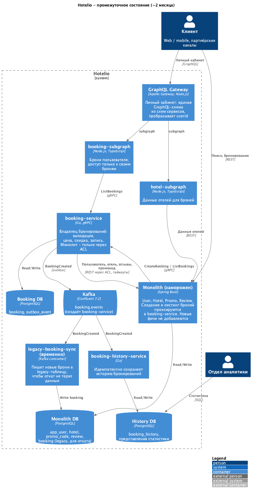

# ADR-002. Первый выносимый модуль - Booking: выбор, план выноса и промежуточное состояние

### **Название задачи:** Выбор первого модуля для выноса из монолита Hotelio, план его выноса по Strangler Fig и промежуточное состояние системы (~2 месяца)

### **Автор:** Bulat Aikaev

### **Дата:** 2026-10-11

Связанные решения: [ADR-001 - целевая архитектура и план перехода](ADR-001-target-architecture.md). Реализация - `tasks/task2/`.

### **Функциональные требования**

| № | Действующие лица или системы | Use Case | Описание |
| :-: | :- | :- | :- |
| UC-1 | Клиент -> монолит -> `booking-service` | Создание брони через новый сервис | Монолит проксирует создание брони в `booking-service`, внешний контракт не меняется |
| UC-2 | Клиент -> монолит -> `booking-service` | Просмотр броней | Монолит проксирует просмотр броней в `booking-service` |
| UC-3 | `booking-service` -> Kafka -> `booking-history-service` | Публикация и учёт события | Событие о новой брони доходит до сервиса истории |
| UC-4 | Оператор (DevOps) | Перенос данных | Перенос броней из монолита в `booking-db`, пока монолит работает - шаг 2 плана |
| UC-5 | Оператор (DevOps) | Переключение и откат | Включение нового сервиса и возврат на монолит без простоя - шаг 3 плана |

Пошаговое описание:

**UC-1. Создание брони через новый сервис** (диаграмма [`04-booking-strangler`](diagrams/04-booking-strangler.png))

1. Клиент вызывает `POST /api/bookings` монолита, как раньше; прокси `GrpcBookingService` вызывает `CreateBooking` в `booking-service`.
2. `booking-service` через ACL получает от монолита пользователя, отель, признак надёжности и промокод и проверяет правила в том же порядке, что монолит.
3. Сервис считает цену и в одной транзакции сохраняет бронь и событие `BookingCreated`.
4. Монолит отдаёт клиенту прежний JSON; при отказе - прежний HTTP 500.

**UC-2. Просмотр броней**

1. Клиент вызывает `GET /api/bookings?userId=...`; прокси вызывает `ListBookings`.
2. `booking-service` читает брони из своей БД.

**UC-3. Публикация и учёт события**

1. Фоновый процесс публикует неопубликованные события из outbox в `booking.events`.
2. `booking-history-service` идемпотентно сохраняет бронь в историю.

### **Нефункциональные требования**

| № | Требование | Как обеспечиваем |
| :-: | :- | :- |
| НФТ-1 | **Бизнес-ценность.** Вынос решает проблемы бизнеса: независимое масштабирование и выкатка самого нагруженного и часто меняющегося процесса | Выносим бронирование |
| НФТ-2 | **Минимальный радиус изменений.** Вынос не требует менять другие модули монолита | У Booking нет входящих зависимостей |
| НФТ-3 | **Паритет поведения.** Регресс даёт одинаковый результат против монолита и нового сервиса | Логика переносится один в один; регресс против обеих реализаций |
| НФТ-4 | **Совместимость контракта.** Внешний REST-контракт бронирований не меняется | Готовая точка переключения `GrpcBookingService` |
| НФТ-5 | **Обратимость.** Переключение и откат - конфигурацией, без изменения кода | Переменные `BOOKING_SERVICE_EXTERNAL_HOST/PORT`; обратная синхронизация на период отката |
| НФТ-6 | **Согласованность данных.** Нет потерянных броней и событий, идентификаторы не конфликтуют | Сохранение `id`, отдельный диапазон `id` сервиса, outbox, сверка |
| НФТ-7 | **Устойчивость к отказам монолита.** Недоступность монолита - понятная ошибка, а не зависание | Таймауты на вызовы монолита; gRPC-статусы `UNAVAILABLE` / `FAILED_PRECONDITION` |
| НФТ-8 | **Отдельная БД.** Сервис не работает с таблицами монолита напрямую | `booking-db` только у `booking-service`; данные монолита - через его API (исключение - чтение из двух источников на время переключения, см. ADR-001) |
| НФТ-9 | **Ресурсы.** Реализуемо силами 2 бэкенд-разработчиков | Один сервис на Go (ADR-001), готовый контракт |
| НФТ-10 | **Без простоя.** Перенос данных, переключение и откат не останавливают работу с бронями | Копии, пока монолит работает; синхронизация в обе стороны; поочерёдный перезапуск монолита |

### **Решение**

Первым выносим **Booking** в отдельный сервис `booking-service`. Контекст системы не меняется ([`00-context`](diagrams/00-context.png)) - меняется её внутреннее устройство.

#### Почему Booking

Кандидаты сравнивались по критериям из [ADR-001](ADR-001-target-architecture.md#порядок-выноса); сравнение - в разделе "Альтернативы". Решающее - связанность модулей по коду:

| Модуль | Входящие зависимости | Исходящие зависимости | Таблицы | Кто ещё читает таблицы |
|---|---|---|---|---|
| Booking | - (только REST-контроллер) | User, Hotel, Review, Promo | `booking` | никто |
| User | Booking, Promo | - | `app_user` | - |
| Hotel | Booking | - | `hotel` | - |
| Review | Booking | - | `review` | - |
| Promo | Booking | User | `promo_code` | - |

Бронирование даёт больше всего пользы (пиковая нагрузка, самые частые изменения), при этом его никто не вызывает и его таблицу никто не читает, а в монолите уже есть точка переключения `GrpcBookingService`: `@Primary`-наследник `BookingService`, который включается переменными `BOOKING_SERVICE_EXTERNAL_HOST/PORT` и проксирует `createBooking` и `listAll`.

#### Промежуточное состояние (~2 месяца)

| Контейнер | Ответственность | Интеграции |
|---|---|---|
| Монолит (заморожен) | Точка входа для клиентов; User, Hotel, Promo, Review | gRPC к `booking-service` через `GrpcBookingService`; REST-эндпоинты для `booking-service` |
| `booking-service` + `booking-db` | Владелец броней: валидация, цена, скидка, запись | gRPC API по `booking.proto`; REST к монолиту через ACL; Kafka через outbox |
| Kafka | Тема `booking.events`, её создаёт `booking-service` | - |
| `booking-history-service` + `history-db` | История и статистика для аналитики | Подписчик Kafka |
| `legacy-booking-sync` (временно) | Пишет новые брони в legacy-таблицу монолита на период отката | Подписчик Kafka |
| GraphQL Gateway + `booking-subgraph` + `hotel-subgraph` (Node.js, TypeScript) | Личный кабинет: брони пользователя с данными отелей, только свои | gRPC к `booking-service`, REST к монолиту |

#### ACL и маршрутизация для Booking

Принципы - в ADR-001 ([ACL](ADR-001-target-architecture.md#anti-corruption-layer), [маршрутизация](ADR-001-target-architecture.md#маршрутизация)). Для Booking это три адаптера:

- **`booking-service` -> монолит:** пакет `monolith` переводит JSON монолита в модели сервиса (`booking.User`, `booking.Hotel`), 404/400 - в "нет данных", сетевые ошибки - в "монолит недоступен". После выноса `user-service`, `hotel-service`, `review-service` и `promo-service` его части заменяются gRPC-клиентами этих сервисов.
- **Монолит -> `booking-service`:** `GrpcBookingService` переводит сущность `Booking` монолита в `booking.proto` и обратно.
- **`booking-service` -> legacy-таблица:** `legacy-booking-sync` переводит событие `BookingCreated` в строку таблицы `booking` монолита.

Сейчас запросы к бронированию идут через монолит; после этапа "Платформа" API Gateway направляет `/api/bookings` прямо в `booking-service`, для чего сервис отдаёт прежний REST-контракт собственным фасадом.

#### План выноса по Strangler Fig

Перед выносом монолит готовится по этапу 0 плана ADR-001.

**Шаг 1. `booking-service` с паритетом поведения**

- gRPC `CreateBooking` и `ListBookings` по `booking.proto`.
- Валидация и расчёт цены - один в один с монолитом, включая спорные правила; их изменения - отдельными задачами после переключения, за фича-флагами.
- Данные невынесенных модулей - через ACL: `GET /api/users/{id}`, `GET /api/hotels/{id}`, `GET /api/reviews/hotel/{id}/trusted`, `POST /api/promos/validate`, с таймаутом на каждый вызов.
- Своя БД (`booking`, `outbox_event`), миграции встроены в сервис.

**Шаг 2. Перенос данных** - `tasks/task2/migrate-bookings.sh`

Брони в монолите только добавляются, поэтому новые записи - это строки с `id` больше последнего перенесённого, и CDC не нужен.

1. Начальная копия, пока монолит работает. `id` сохраняются (прокси делает `Long.parseLong(id)`), пустые `created_at` заполняются (прокси падает на пустой строке).
2. Последовательность `booking-db` начинается с 1 000 000 000: пока старые и новые экземпляры монолита работают одновременно, `id` не пересекаются, а брони из диапазона сервиса, вернувшиеся в монолит, повторно не копируются.
3. Дозагрузка новых записей - повторные запуски скрипта, во время переключения непрерывно (`--follow`).
4. После каждой копии - сверка количества и суммы цен.

**Шаг 3. Переключение без простоя**

1. Запустить непрерывную дозагрузку и `legacy-booking-sync`, включить защиту чтения (ADR-001): чтение из двух источников в `booking-service` и привязку клиента к экземпляру на балансировщике.
2. Поочерёдно перезапустить экземпляры монолита с `BOOKING_SERVICE_EXTERNAL_HOST/PORT`.
3. После последнего экземпляра - последняя дозагрузка и сверка; задачу миграции и защиту чтения выключить. Прогнать регресс, следить за ошибками и латентностью.
4. **Откат:** так же поочерёдно перезапустить экземпляры без переменных; брони сервиса уже в legacy-таблице благодаря `legacy-booking-sync`.

На стенде задания 2 монолит один, поэтому там переключение - перезапуск с простоем на время старта.

**Шаг 4. Удаление старой реализации**

- После периода стабильной работы удалить из монолита `BookingService`, `BookingRepository`, `GrpcBookingService`, `legacy-booking-sync` и legacy-таблицу.
- Перевести бизнес-отказы на коды 4xx (согласованно с клиентами) и пересмотреть унаследованные правила - уже в `booking-service`.
- На этапе "Платформа" перевести маршрутизацию `/api/bookings` на API Gateway.

### **Альтернативы**

**Какой модуль выносить первым**

| Критерий | **Booking** | Review | Hotel | Promo | User |
|---|---|---|---|---|---|
| Бизнес-ценность выноса | **Высокая** | Низкая | Средняя | Низкая | Средняя |
| Потребность в отдельном масштабировании | **Пиковая** | Низкая | Высокая на чтение, решается кешем | Низкая | Средняя |
| Частота изменений | **Высокая** | Низкая | Средняя | Средняя | Низкая |
| Модули, которые придётся менять | **Ни одного** | Booking | Booking | Booking | Booking, Promo |
| Готовая точка переключения в монолите | **Есть** | Нет | Нет | Нет | Нет |
| Обратные вызовы нового сервиса в монолит | 4 (минус) | 0 | 0 | 1 | 0 |
| Риск | Средний | Низкий | Низкий | Низкий | Высокий |

Модули, которые сами никого не вызывают (`Review`, `Hotel`), выносятся проще, но почти не решают проблем бизнеса и без готовой точки переключения потребовали бы ещё и изменений в `BookingService` монолита.

**Как `booking-service` получает данные невынесенных модулей**

| Вариант | Решение |
|---|---|
| **REST к монолиту через ACL** | Выбрано на переходный период: эндпоинты уже есть, монолит не меняется |
| Прямое чтение таблиц монолита | Отклонено: связывает схемы (НФТ-8) |
| Локальные read-модели по событиям | Целевой вариант - после выноса соответствующих модулей |

**Как публиковать событие `BookingCreated`**

| Вариант | Решение |
|---|---|
| Отправка в Kafka сразу после записи в БД | Отклонено: при сбое между записью и отправкой событие теряется |
| CDC (Debezium) | Отклонено: ещё один компонент для одного DevOps |
| **Transactional outbox** | Выбрано: атомарно с записью брони, без новых компонентов |

**Как переносить данные**

| Вариант | Решение |
|---|---|
| Разовая копия в окно обслуживания | Отклонено: останавливает создание броней (НФТ-10) |
| **Начальная копия + дозагрузка новых записей по `id`** | Выбрано: брони только добавляются, поэтому дельта по `id` точная |
| CDC (Debezium) | Отклонено для броней: то же самое ценой ещё одного компонента |
| Двойная запись из монолита | Отклонено: монолит поставляется готовым JAR |

**Недостатки, ограничения, риски**

Общие риски миграции (обратные вызовы в монолит, монолит в пути запросов, синхронизация в обе стороны, расхождение с legacy-таблицей) - в ADR-001. Специфичные для Booking:

| Риск / ограничение | Последствие | Мера |
|---|---|---|
| Прокси монолита: `GET /api/bookings` без `userId` падает (`setUserId(null)` -> NPE) | Листинг всех броней через монолит недоступен после переключения | Листинг всех броней - через gRPC или BFF; ограничение исчезает, когда маршрутизацию забирает API Gateway |
| Чтение из двух источников и `legacy-booking-sync` пока не реализованы | На стенде нет защиты чтения при переключении; откат после первой новой брони теряет брони сервиса | Реализовать до боевого переключения |
| Монолит дорастёт до диапазона `id` сервиса | Столкновение идентификаторов | Скрипт отказывается работать, если `id` монолита достигли начала диапазона; запас - миллиард броней |
| В проде один экземпляр монолита | Переключение без простоя невозможно | Перед переключением поднять второй экземпляр за балансировщиком |
| gRPC-канал монолита не сразу видит перезапущенный `booking-service` (новый IP) | Кратковременные `UNAVAILABLE` после рестарта сервиса | Стабильный адрес сервиса (Kubernetes Service), ретраи на уровне mesh |
| Спорные бизнес-правила и HTTP 500 для бизнес-отказов перенесены как есть | Спорный расчёт цены; клиенты не отличают отказ от сбоя | Осознанно ради паритета; исправления за фича-флагами, переход на 4xx - после согласования с клиентами |
